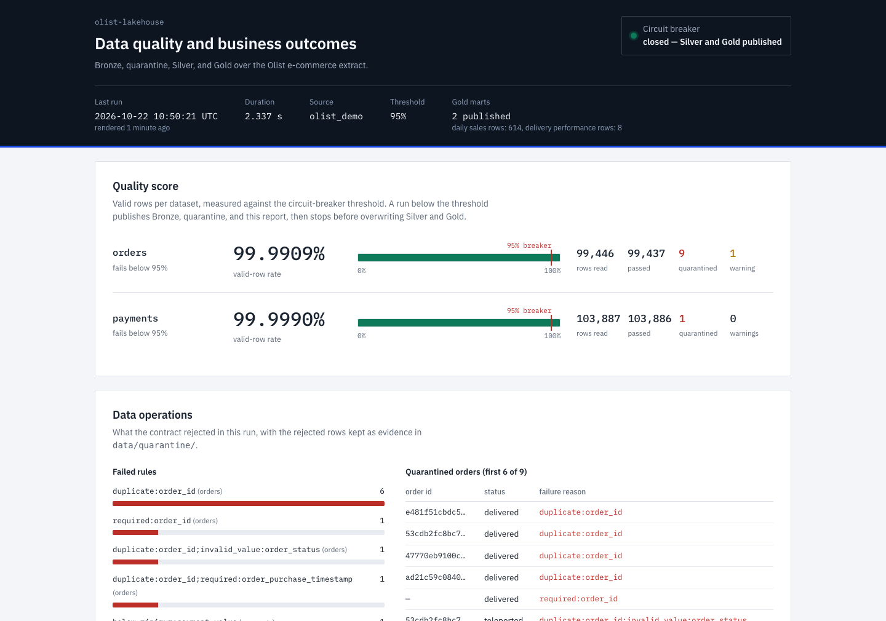
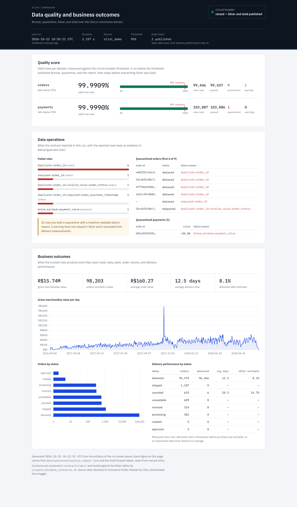

# Olist Lakehouse: Data Quality Contracts

An end-to-end local data engineering project using the public Olist Brazilian E-Commerce dataset. The pipeline turns raw CSV extracts into governed Bronze, Silver, and Gold tables while isolating invalid records instead of silently loading them.

## Portfolio story

E-commerce source data changes and degrades in production: required values are missing, keys are duplicated, and monetary values are invalid. This project applies a data contract before downstream transformations so that unreliable records are quarantined, healthy records continue to flow, and the data team can measure trust in the platform.

```text
Olist CSV extracts
      |
      v
Bronze: immutable raw tables
      |
      +--> data contract checks --> quarantine table + quality metrics
      |
      v
Silver: cleaned, typed, deduplicated tables
      |
      v
Gold: daily sales and delivery-performance marts --> BI dashboard
```

## Stack

- Python/Pandas for the local MVP; PySpark is included for the distributed-processing milestone
- Delta Lake / Parquet tables for the lakehouse layers
- Great Expectations-compatible YAML contracts (initially evaluated by project code)
- DuckDB for local inspection and dashboard-ready marts
- A generated static dashboard (`docs/generated/dashboard.html`) covering the operations and business views, built by `python -m olist_lakehouse.dashboard`

## Data source

Download **Brazilian E-Commerce Public Dataset by Olist** from Kaggle and place the CSV files in `data/raw/olist/`. Do not commit the full source dataset. The raw data is used for learning and portfolio demonstration only; see the source dataset's terms before redistribution.

Expected files for the first MVP:

```text
data/raw/olist/
├── olist_orders_dataset.csv
├── olist_order_items_dataset.csv
├── olist_order_payments_dataset.csv
├── olist_customers_dataset.csv
└── olist_products_dataset.csv
```

## How to run

### 1. Install the project

```bash
git clone https://github.com/<your-github-username>/olist-lakehouse.git
cd olist-lakehouse
python3 -m venv .venv
.venv/bin/pip install -e '.[dev]'
```

### 2. Download the source data

Download the Olist CSV archive from [Kaggle](https://www.kaggle.com/datasets/olistbr/brazilian-ecommerce), extract it, and copy the five CSV files listed above into `data/raw/olist/`.

### 3. Make the demo input

```bash
.venv/bin/python scripts/inject_quality_issues.py
```

This creates `data/raw/olist_demo/` and deliberately adds missing keys, duplicate order IDs, an invalid order status, a missing timestamp, a delivery-date warning, and a negative payment. The original download remains unchanged.

### 4. Run the lakehouse pipeline

```bash
.venv/bin/python -m olist_lakehouse.pipeline
```

### 5. Validate the trusted data product contract

```bash
./scripts/validate_contracts.sh
```

### 6. Build the dashboard

```bash
.venv/bin/python -m olist_lakehouse.dashboard
```

This writes `docs/generated/dashboard.html`, a self-contained page showing the quality score against the circuit-breaker threshold, failed rules, quarantined-row samples, and the Gold business views. Every number is read from the artifacts of step 4. Open the file in a browser; the two charts load from the Chart.js CDN, so they need an internet connection.

## Expected result

The pipeline should exit successfully because the injected defects are well below the 95% circuit-breaker threshold. It prints a JSON run report and writes these ignored local artifacts:

```text
data/processed/
├── bronze/orders.parquet
├── bronze/payments.parquet
├── silver/orders.parquet
├── silver/payments.parquet
├── gold/daily_sales.parquet
├── gold/delivery_performance.parquet
├── quality_report.csv
└── quality_report.json

data/quarantine/
├── orders.parquet        # failed rows and failure_reason
└── payments.parquet
```

Verified run on the full Kaggle extract (99,441 orders, 103,886 payments) plus the injected defects:

| Dataset | Rows read | Valid | Quarantined | Valid-row rate |
| --- | --- | --- | --- | --- |
| orders | 99,446 | 99,437 | 9 | 99.9909% |
| payments | 103,887 | 103,886 | 1 | 99.9990% |

The 9 quarantined order rows are `duplicate:order_id` (6), `required:order_id` (1), `duplicate:order_id;invalid_value:order_status` (1), and `duplicate:order_id;required:order_purchase_timestamp` (1). Duplicating a key quarantines *both* copies, because the pipeline has no survivorship rule for deciding which record is authoritative — that is a deliberate, documented limitation. One negative payment is quarantined as `below_minimum:payment_value`. The delivery date before purchase is reported as a warning (1 on orders) rather than blocking the record.

Gold produces 614 daily-sales rows (2016-09-04 → 2018-09-03, R$ 15,738,749 total GMV) and 8 delivery-performance rows, one per order status. The whole run takes under 2 seconds on a laptop (1.3–2.1 s across runs: ingest → contract evaluation → quarantine → Silver → Gold → run report). `validate_contracts.sh` first lints both ODCS YAML files and then runs 39 checks that both Silver data products comply with their contracts.

To prove the circuit breaker, temporarily increase the injected bad-record volume above 5% and re-run the pipeline. It still writes Bronze, the quarantine tables, and a quality report marked `"circuit_breaker": "open"`, raises `Circuit breaker opened`, and leaves the Silver and Gold tables published by the last healthy run untouched.

## Dashboard

Step 6 writes `docs/generated/dashboard.html`. Two committed screenshots show what it renders:





## MVP success criteria

- [x] Raw source files are ingested into a Bronze layer without overwriting inputs.
- [x] The orders contract catches null keys, invalid statuses, invalid timestamps, negative payment values, and duplicated order IDs.
- [x] Invalid records are written to quarantine with a clear failure reason.
- [x] Silver orders preserve only valid records and standardize timestamps/types.
- [x] Gold marts answer daily sales and delivery-performance questions.
- [x] Dashboard exposes freshness, quality score, failed-rule counts, quarantine volume, and core sales metrics.

## Repository map

```text
contracts/       Data-quality rules and expected schemas
docs/            Architecture, decisions, Notion-ready narrative, and generated HTML (dashboard and contracts)
scripts/         Dataset preparation utilities
src/             Pipeline source code
tests/           Automated checks
data/             Ignored local inputs and generated outputs
```

## Data-contract workflow

The formal data product contracts are the ODCS files in `contracts/odcs/`. The free, open-source Data Contract CLI lints them and validates the resulting Silver Parquet tables. The Python validator remains responsible for row-level quarantine at ingestion, while ODCS documents and verifies the trusted output contract.

```bash
./scripts/validate_contracts.sh
.venv/bin/datacontract export html contracts/odcs/orders.odcs.yaml --output docs/generated/orders-contract.html
```

The HTML document can be committed and hosted with the repository or linked from the Notion case study.

## Roadmap

1. [x] Local batch MVP with Olist orders and payments.
2. [ ] Add the remaining Olist dimensions, more Gold marts, and a PySpark implementation.
3. [ ] Schedule runs with Airflow and send an alert when a quality threshold is breached.
4. [ ] Capture dashboard screenshots and write the Notion case study.
